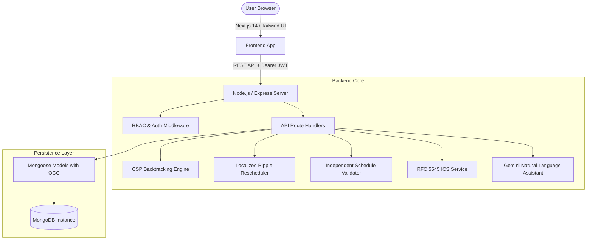

# TIMORA Architectural Specification

## 1. High-Level System Architecture

Timora uses a decoupled, event-driven client-server model built on a modern TypeScript stack:



## 2. Role-Based Access Control (RBAC)

The platform enforces strict server-side RBAC across three core roles:

1. **Admin / Placement Coordinator**:
   - Master schedule generation and publication.
   - Placement drive creation and round structuring.
   - Room venue capacity, equipment management, and live occupancy inspection.
   - Candidate eligibility management and CV inspection.
   - Interviewer panel availability window configuration.

2. **Interviewer**:
   - Access to nearest upcoming interviews and chronological rosters.
   - Submission of free time windows.
   - Emergency cancellation trigger activating localized ripple-effect auto-repair.
   - Live rubric evaluation sheets that update candidate progression ($Coding \rightarrow Tech \rightarrow HR$).

3. **Candidate**:
   - Tracking current recruitment stage and upcoming scheduled rounds.
   - Submitting availability windows.
   - Atomic self-booking interface restricted to verified CSP-feasible slots.
   - Profile management including PDF CV upload and replacement.

## 3. Concurrency & Data Consistency Strategy

### Optimistic Concurrency Control (OCC)
To guarantee that concurrent candidates cannot reserve the same room, interviewer panel, or time slot, `InterviewSessionModel` enforces Mongoose `optimisticConcurrency: true` (version key `version` / `__v`).

When a booking request arrives:
1. An atomic query checks for overlapping sessions across candidate, interviewer IDs, or room:
   ```typescript
   InterviewSessionModel.findOne({
     status: 'Scheduled',
     startMs: { $lt: requestedEffectiveEndMs },
     effectiveEndMs: { $gt: requestedStartMs },
     $or: [
       { roomId },
       { candidateId },
       { interviewerIds: { $in: interviewerIds } },
     ],
   });
   ```
2. If an overlap exists, HTTP 409 Conflict is returned immediately.
3. If clean, atomic `$set` and `$inc: { version: 1 }` commits the reservation.

## 4. Design System Architecture

- **Color Tokens**: Pure monochrome palette (`#0a0a0a` black, `#ffffff` white, `#f5f5f5` neutral light gray, `#262626` / `#525252` neutral dark grays).
- **Typography**: Inter for UI prose, JetBrains Mono for ISO timestamps, metrics, and room codes.
- **Component Hierarchy**: `ApplicationShell` provides role-locked sidebar navigation and user identity header, wrapping role-specific modular workspaces.

